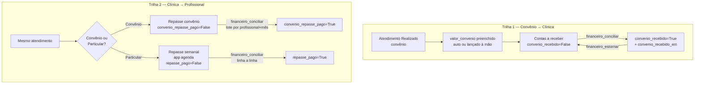

# Detalhe — `agenda` (Agendamento, PagamentoParticular) e `financeiro`

> Gerado em 2026-07-21. Documento de aprofundamento sobre o [mapa-geral-projeto.md](mapa-geral-projeto.md)
> (seção "agenda"/"financeiro"), focado só nestes dois apps. Fontes: `agenda/models.py`,
> `agenda/views.py`, `agenda/forms.py`, `financeiro/models.py`, `financeiro/views.py`,
> `financeiro/urls.py`, `financeiro/forms.py`, `accounts/permissoes.py`,
> `accounts/management/commands/seed_perfis.py`.

## 1. `Agendamento` — campos de valor, convênio, pagamento e data

`financeiro` não tem model próprio — todo o dinheiro do sistema mora nestes campos de
`agenda.Agendamento` (mais `PagamentoParticular`, seção 2). Abaixo, só os campos relacionados a
valor/convênio/pagamento/data — para os demais campos do model (paciente, profissional,
procedimento, status, observações, encaixe, série de recorrência, retorno) ver `agenda/models.py`.

### Campos de banco (colunas reais)

| Campo | Tipo | Significado |
|---|---|---|
| `forma_atendimento` | `CharField(10)`, choices `CONVENIO`/`PARTICULAR`, default `PARTICULAR` | Define qual trilha de cobrança se aplica a ESTE atendimento específico. Um paciente pode ter convênio cadastrado e ainda assim atender particular numa consulta pontual. |
| `convenio` | FK → `cadastros.Convenio`, `SET_NULL`, null/blank | Convênio usado neste atendimento (só relevante quando `forma_atendimento=CONVENIO`). `SET_NULL`: se o convênio for excluído do cadastro, o agendamento não é apagado nem travado, só perde a referência. |
| `valor_convenio` | `DecimalField(8,2)`, null/blank | Quanto a clínica tem a receber do convênio por este atendimento. **Só se aplica a convênio.** Preenchido automaticamente quando o agendamento é marcado como `Realizado` e há preço configurado (`Convenio.valor_para` — tabela de preço do convênio). Quando não há preço configurado, fica em branco (`None`) e precisa ser lançado à mão em Financeiro → Contas a receber (`financeiro:contas_receber_lancar`). Retorno grátis (`eh_retorno`) força este campo para `0.00` sempre, sem exceção. |
| `convenio_recebido` | `BooleanField`, default `False` | "A clínica já recebeu do convênio este valor?" — ver seção 5 para o fluxo completo de quem marca e quando. |
| `convenio_recebido_em` | `DateTimeField`, null/blank | Timestamp de quando `convenio_recebido` virou `True`. `None` enquanto pendente. |
| `convenio_repasse_pago` | `BooleanField`, default `False` | Campo **diferente** do anterior — é sobre o repasse **clínica → profissional** da parte de convênio (não convênio → clínica). Aqui não existe "aguardando convênio": a tela de repasse sempre trata o convênio como já recebido; só existe "a repassar" × "repassado". |
| `convenio_repasse_pago_em` | `DateTimeField`, null/blank | Timestamp de quando `convenio_repasse_pago` virou `True`. Marcado sempre em lote (ver seção 4), nunca convênio-a-convênio. |
| `data_hora_inicio` | `DateTimeField` | Início do atendimento. É o campo usado como "data do agendamento" em praticamente todos os relatórios/filtros do financeiro (semana, mês, dia). |
| `data_hora_fim` | `DateTimeField` | Término do atendimento. Usado só para conflito de agenda, não entra em cálculos financeiros. |
| `criado_em` | `DateTimeField(auto_now_add)` | Quando a linha foi criada. Não é usado em nenhum relatório financeiro (que sempre filtram por `data_hora_inicio`). |
| `atualizado_em` | `DateTimeField(auto_now)` | Última modificação de qualquer campo da linha. Idem — não entra em relatórios. |

### Properties calculadas (não são colunas — não existem no banco)

Ficam no model como conveniência, recalculadas a cada acesso:

| Property | Devolve | Significado |
|---|---|---|
| `eh_retorno` | `bool` | `True` quando `retorno_de_id is not None` — atendimento é um retorno grátis detectado automaticamente (30 dias corridos, mesma especialidade). Usado para zerar cobrança em vários pontos (ver `valor_a_cobrar` e o auto-preenchimento de `valor_convenio` em `agendamento_mudar_status`). |
| `valor_cobrado` | `Decimal` ou `None` | Soma de `PagamentoParticular.valor` deste agendamento, **excluindo** linhas estornadas. `None` se ainda não há nenhuma linha (diferente de `0`, que significa "já tem linha(s), soma zero" — ex.: cortesia). |
| `valor_estornado` | `Decimal` (nunca `None`) | Soma das linhas de `PagamentoParticular` com `estornado=True`. `Decimal("0.00")` quando não há nenhuma. |
| `valor_a_cobrar` | `Decimal` ou `None` | Quanto **deveria** ser cobrado, calculado (nunca digitado à mão): `Procedimento.valor_particular` se particular, `Convenio.valor_para(...)` se convênio. Sempre `0.00` se `eh_retorno`. `None` quando falta cadastro de preço — nesse caso a tela de pagamento bloqueia em vez de aceitar valor digitado. |
| `carteirinha_vencida_no_atendimento` | `bool` | `True` se o atendimento é por convênio e a validade da carteirinha do paciente (`Paciente.validade_carteirinha`) já passou na data do atendimento. É só um alerta visual — não bloqueia nada. |

**Nota:** `status` não é um campo de valor, mas é o "portão" que libera os cálculos acima —
`valor_convenio` só é preenchido quando `status` vira `REALIZADO`, e `contas_receber_lista`/`painel_financeiro`
só consideram agendamentos `REALIZADO`. Cancelar um agendamento (`status=CANCELADO`) **não limpa**
`valor_convenio`/`convenio_recebido` — ver nota de bug na seção 5.

## 2. `PagamentoParticular` — todos os campos

Representa **uma forma de pagamento** de um atendimento particular. Um mesmo `Agendamento` pode ter
até 2 linhas (pagamento dividido, ex. metade dinheiro/metade cartão) — o limite de 2 é aplicado no
`ConfirmarPagamentoForm` (`agenda/forms.py`), não no model. Cortesia também vira uma linha aqui, com
`valor=0`.

| Campo | Tipo | Significado |
|---|---|---|
| `agendamento` | FK → `Agendamento`, `CASCADE`, related_name `pagamentos` | A qual atendimento esta forma de pagamento pertence. `CASCADE`: excluir o agendamento exclui os pagamentos junto. |
| `forma_pagamento` | `CharField(20)`, choices de `Agendamento.FormaPagamento` (`DINHEIRO`, `CARTAO_DEBITO`, `CARTAO_CREDITO`, `PIX`, `CORTESIA`) | Meio de pagamento desta linha. Determina a regra de repasse: dinheiro é repassado no mesmo dia (já entregue), cartão/Pix ficam pendentes "no decorrer da semana", cortesia nunca gera repasse. |
| `valor` | `DecimalField(8,2)` | Valor desta forma de pagamento (não do atendimento inteiro, caso dividido). `0` para cortesia. |
| `repasse_pago` | `BooleanField`, default `False` | Se o repasse desta linha específica ao profissional já foi pago. Controle **por linha**, não por agendamento — necessário porque a regra de quando repassar depende da forma de pagamento de cada linha. |
| `repasse_pago_em` | `DateTimeField`, null/blank | Timestamp de quando `repasse_pago` virou `True`. |
| `estornado` | `BooleanField`, default `False` | Se este pagamento foi devolvido ao paciente. |
| `estornado_em` | `DateTimeField`, null/blank | Timestamp do estorno. |
| `estornado_por` | FK → `accounts.Usuario`, `SET_NULL`, null/blank, related_name `pagamentos_estornados` | Quem estornou. |
| `motivo_estorno` | `TextField`, blank | Motivo digitado no estorno (obrigatório no formulário `EstornoPagamentoForm`, embora o campo do model aceite branco). |
| `criado_em` | `DateTimeField(auto_now_add)` | Quando a linha de pagamento foi registrada. |

Regra de negócio embutida no fluxo (não no model): se `repasse_pago` já era `True` no momento do
estorno, a view `financeiro.views.pagamento_estornar` desfaz o repasse automaticamente
(`repasse_pago` volta a `False`, `repasse_pago_em` a `None`) e avisa o usuário que precisa acertar a
diferença manualmente com o profissional se o dinheiro já tiver sido entregue em mãos.

## 3. Conciliação no app `financeiro`

`financeiro` não tem model — é só um conjunto de telas de consulta/ação em cima de
`Agendamento`/`PagamentoParticular`. Existem **duas trilhas de dinheiro** que passam por ele, e é
fácil confundi-las:



As duas trilhas são **independentes**: marcar `convenio_recebido=True` não afeta
`convenio_repasse_pago`, e vice-versa. A tela de repasse (Trilha 2) sempre trata o convênio como
"já recebido pela clínica" — essa distinção só existe na Trilha 1.

### Todas as views do app `financeiro` (`financeiro/urls.py`)

| URL name | Função | Permissão exigida | O que mostra/faz |
|---|---|---|---|
| `painel` | `painel_financeiro` | `financeiro_ver_painel` | Dashboard semanal: recebido particular (por forma), caixa em dinheiro da semana, estornos da semana, repasse pendente ao profissional (resumo, com link pro detalhe), convênio a receber × já recebido na semana, atendimentos realizados, cortesias e retornos. Não tem nenhuma ação, só leitura. |
| `fila_pagamento_lista` | `fila_pagamento_lista` | `fila_autorizar_financeiro` | Fila de trabalho (não histórico): agendamentos em `PRE_AUTORIZADO` esperando o financeiro registrar pagamento. Cada linha tem um link "Registrar pagamento" que leva para `agenda:agendamento_confirmar_pagamento` (essa tela de fato mora no app **agenda**, não financeiro). |
| `contas_receber_lista` | `contas_receber_lista` | `financeiro_ver_contas_receber` | Lista de atendimentos por convênio já `Realizado`, agrupada por convênio (agrupamento só visual, montado em Python a cada request — nada é persistido). Duas abas: "A receber" (`convenio_recebido=False`) e "Já recebidos/histórico" (`True`). Filtro por convênio. Exclui retornos grátis (nunca têm nada a receber). |
| `contas_receber_lancar` | `contas_receber_lancar_valor` | `financeiro_lancar` | Formulário para preencher/corrigir manualmente `valor_convenio`, usado quando `Convenio.valor_para` não achou preço configurado. Bloqueia explicitamente se o agendamento for retorno grátis. |
| `contas_receber_marcar_recebido` | `contas_receber_marcar_recebido` | `financeiro_conciliar` | "Dar baixa" — ver seção 5 (fluxo completo). |
| `contas_receber_estornar` | `contas_receber_estornar` | `financeiro_estornar` | Desfaz uma baixa dada por engano — ver seção 5. |
| `pagamento_estornar` | `pagamento_estornar` | `financeiro_estornar_pagamento` | Estorna uma linha de `PagamentoParticular` (devolve dinheiro ao paciente). Diferente do anterior: aqui é dinheiro de verdade voltando, por isso exige motivo e tela de confirmação. Se o repasse já estava pago, desfaz automaticamente e avisa o usuário. |
| `fechamento_diario` | `fechamento_diario` | `financeiro_ver_fechamento_diario` | Fechamento do dia: repasse por profissional (+ visão do proprietário), convênios por procedimento (só contagem, sem valor), retornos por especialidade, particular por procedimento/forma. Tela pensada para ser impressa/entregue. |
| `fechamento_mensal` | `fechamento_mensal` | `financeiro_ver_fechamento_mensal` | Igual ao diário, mas para o mês calendário inteiro. |
| `meu_fechamento_diario` | `meu_fechamento_diario` | `financeiro_ver_proprio` | Versão "só a minha produção" do fechamento diário, para o profissional logado (via `Usuario.profissional_id`). Se for o proprietário, também mostra a retenção sobre os demais. |
| `meu_fechamento_mensal` | `meu_fechamento_mensal` | `financeiro_ver_proprio` | Igual, para o mês inteiro. |
| `relatorio_detalhado` | `relatorio_detalhado` | `financeiro_ver_relatorio_detalhado` | Único relatório que mostra paciente + procedimento por atendimento individual (os fechamentos são sempre resumos agrupados). Modo dia ou mês, filtro por profissional. |
| `repasse_convenio_lista` | `repasse_convenio_lista` | `financeiro_ver_repasse_convenio` | "Repasse aos profissionais (convênio)" — por profissional, quebrado por convênio e procedimento, com retenção/líquido. Sempre por mês. Botão de ação (ver próxima linha) só aparece para quem tem `financeiro_conciliar`. |
| `repasse_convenio_marcar_pago` | `repasse_convenio_marcar_pago` | `financeiro_conciliar` | "Marcar tudo como repassado" — a única ação em **lote** de todo o módulo (ver seção 4): paga de uma vez todos os atendimentos de convênio ainda pendentes de UM profissional em UM mês. Não existe "marcar por convênio" isoladamente. |
| `producao_por_convenio` | `producao_por_convenio` | `financeiro_ver_producao_convenio` | Controle interno: quanto a clínica produziu por convênio/especialidade/procedimento, com valores (diferente do fechamento, que só conta quantidade). Particular entra como um grupo informativo à parte. Só leitura. |

### Views "irmãs" que ficam no app `agenda`, não no `financeiro`

Duas telas usam as **mesmas permissões financeiras** e fazem parte do mesmo fluxo de conciliação,
mas fisicamente moram em `agenda/views.py` — vale ter isso claro para não procurá-las no app errado:

| URL name | App | Permissão | O que faz |
|---|---|---|---|
| `agenda:relatorio_repasses_semanal` | `agenda` | `financeiro_ver_repasses_semanais` | Equivalente de "Contas a receber" só que para o repasse **particular** (cartão/Pix pendentes de repasse na semana — dinheiro e cortesia nunca aparecem aqui). |
| `agenda:repasse_marcar_pago` | `agenda` | `financeiro_conciliar` | "Dar baixa" de uma linha de `PagamentoParticular` — equivalente particular do `contas_receber_marcar_recebido`, mas linha a linha (uma forma de pagamento por vez), não em lote. |
| `agenda:agendamento_confirmar_pagamento` | `agenda` | `fila_autorizar_financeiro` | Tela de registrar pagamento/cortesia que avança `PRE_AUTORIZADO → AUTORIZADO`. É para onde `financeiro:fila_pagamento_lista` linka. |

### Permissões do departamento "Financeiro" (`accounts/permissoes.py`)

> Até 27/07, `financeiro_ver_completo` liberava as 9 primeiras linhas abaixo de uma vez só. Dividida
> em uma permissão por página em 28/07 (pedido do cliente) — migration
> `accounts.0015_dividir_permissoes_financeiro` migrou quem já tinha ela pras 9 novas.

| Permissão | Descrição oficial | Perfil padrão que tem (`seed_perfis.py`) |
|---|---|---|
| `financeiro_ver_painel` | Ver o painel financeiro (resumo da semana) | Financeiro, Administrador |
| `financeiro_ver_movimentacoes_avulsas` | Ver movimentações avulsas de caixa | Financeiro, Administrador |
| `financeiro_ver_contas_receber` | Ver contas a receber de convênio | Financeiro, Administrador |
| `financeiro_ver_repasses_semanais` | Ver repasses semanais (particular) | Financeiro, Administrador |
| `financeiro_ver_fechamento_diario` | Ver fechamento diário | Financeiro, Administrador |
| `financeiro_ver_fechamento_mensal` | Ver fechamento mensal | Financeiro, Administrador |
| `financeiro_ver_relatorio_detalhado` | Ver relatório detalhado | Financeiro, Administrador |
| `financeiro_ver_repasse_convenio` | Ver repasse aos profissionais (convênio) | Financeiro, Administrador |
| `financeiro_ver_producao_convenio` | Ver produção por convênio | Financeiro, Administrador |
| `financeiro_ver_proprio` | Ver apenas o próprio financeiro/produção (profissional) | Médico/Profissional de saúde, Administrador |
| `financeiro_lancar` | Lançar valores no financeiro | Financeiro, Administrador |
| `financeiro_conciliar` | Conciliar pagamentos | Financeiro, Administrador |
| `financeiro_estornar` | Estornar baixa de convênio (não mexe em dinheiro) | Financeiro, Administrador |
| `financeiro_estornar_pagamento` | Estornar pagamento particular (devolve dinheiro ao paciente) | Financeiro, Administrador |
| `fila_autorizar_financeiro` | Autorizar paciente na fila (etapa financeiro) | Financeiro, Administrador |

Nenhum outro perfil padrão (Recepção/Atendimento, Apoio clínico) tem qualquer permissão deste
departamento.

### Auditoria (`LogAuditoria`) — cobertura desigual

Nem toda ação financeira gera registro em `LogAuditoria`:

| Ação | Gera log? |
|---|---|
| `contas_receber_estornar` (desfazer baixa de convênio) | ✅ Sim |
| `pagamento_estornar` (estornar pagamento particular) | ✅ Sim |
| `agendamento_confirmar_pagamento` (registrar pagamento) | ✅ Sim |
| `contas_receber_marcar_recebido` (dar baixa de convênio) | ❌ Não |
| `contas_receber_lancar_valor` (lançar/corrigir valor) | ❌ Não |
| `repasse_convenio_marcar_pago` (repasse em lote) | ❌ Não |
| `repasse_marcar_pago` (repasse particular linha a linha) | ❌ Não |

Ou seja: as ações que **desfazem** algo (estornos) são sempre logadas; as ações "diretas" (dar
baixa, lançar valor, marcar repasse) hoje não deixam rastro no log de auditoria, só na mensagem de
sucesso da tela e nos timestamps (`convenio_recebido_em`, `repasse_pago_em` etc.) do próprio registro.

## 4. Noção de "lote" / "envio ao convênio" / agrupamento

**Não existe** hoje nenhum conceito de lote de cobrança, remessa/envio ao convênio, número de guia
ou fatura no sistema. Não há campo `data_envio_convenio`, `numero_lote`, `numero_guia` nem
equivalente em nenhum model — confirmado por busca no código inteiro (`agenda`, `financeiro`,
`cadastros`). O que existe, e que pode ser confundido com isso:

1. **Agrupamento por convênio em `contas_receber_lista`** — é só uma organização visual da tela
   (um `dict` montado em Python a cada request, `financeiro/views.py`, função `contas_receber_lista`).
   Nada é persistido; "dar baixa" continua sendo **um agendamento por vez** (um POST = uma linha).
2. **`repasse_convenio_marcar_pago` — a única ação de lote real do sistema.** Atualiza em massa
   (`.update(...)`) todos os `Agendamento` de convênio ainda pendentes de **um profissional** dentro
   de **um mês calendário**, de uma vez. Mas isso é o repasse da clínica **ao profissional**, não uma
   cobrança/remessa **ao convênio** — não tem relação com "enviar cobrança pro convênio".
3. **`producao_por_convenio`** — soma valores por convênio/especialidade/procedimento num mês, mas é
   puramente informativo: recalculado a cada request, nada fica gravado como "fechamento do mês" ou
   "lote enviado".
4. **`Convenio.prazo_pagamento_dias`** (`cadastros/models.py`) — existe um campo de "prazo médio de
   pagamento" por convênio, mas ele é **só informativo**: aparece no cadastro do convênio e é citado
   em um comentário de `financeiro/views.py` (linha ~161) como o motivo de `contas_receber_lista` não
   ter recorte semanal. Ele **não** é usado para calcular uma data de vencimento em `Agendamento`, nem
   para sinalizar atraso, nem para nada automatizado — é texto de apoio para quem olha o cadastro.

Em resumo: cada `Agendamento` de convênio é uma unidade de cobrança isolada do ponto de vista do
sistema. Se a clínica hoje agrupa vários atendimentos numa única guia/fatura para enviar ao
convênio, isso acontece **fora do sistema** (planilha, portal do convênio etc.) — o SMEDIM não tem
nenhuma representação disso.

## 5. `convenio_recebido` — quem marca, onde, e o que acontece depois

### Pré-condições

- O agendamento precisa estar `REALIZADO` e ser `forma_atendimento=CONVENIO`.
- Precisa ter `valor_convenio` preenchido — o botão "Marcar como recebido" só aparece no template
  (`financeiro/templates/financeiro/contas_receber_lista.html`) quando
  `perms.accounts.financeiro_conciliar` **e** `item.valor_convenio` são verdadeiros. Sem valor
  lançado, a única ação disponível é "Lançar valor" (permissão `financeiro_lancar`, view separada).
- Retornos grátis (`eh_retorno`) nunca aparecem nesta lista (filtro `retorno_de__isnull=True`) — como
  o valor é sempre forçado a `0.00`, não há o que "receber".

### Quem marca e onde

- **Permissão:** `accounts.financeiro_conciliar` (perfis padrão: Financeiro, Administrador).
- **Tela:** Financeiro → Contas a receber, aba "A receber" (`financeiro:contas_receber_lista`),
  botão "Marcar como recebido" em cada linha.
- **View:** `financeiro.views.contas_receber_marcar_recebido(pk)` — só aceita `POST`; acessar via
  `GET` direto apenas redireciona de volta sem mudar nada (proteção padrão usada em todas as ações de
  "dar baixa"/"estornar" do app).

### O que a view faz

```python
agendamento.convenio_recebido = True
agendamento.convenio_recebido_em = timezone.now()
agendamento.save(update_fields=["convenio_recebido", "convenio_recebido_em"])
```

Só esses dois campos são tocados (`update_fields` explícito) — `status`, `valor_convenio` e
`convenio_repasse_pago` continuam exatamente como estavam. Não gera `LogAuditoria` (ver tabela na
seção 3).

### O que acontece com o agendamento depois

- **Desaparece da aba "A receber"** (filtro `convenio_recebido=False`) e **passa a aparecer em "Já
  recebidos (histórico)"** (`convenio_recebido=True`), mostrando o timestamp `convenio_recebido_em`.
- **Entra no `painel_financeiro`** da semana em que `convenio_recebido_em` cai — soma
  `convenio_recebido_total` — e **sai** do total `convenio_a_receber_total`/`convenio_a_receber_qtd`
  daquela tela.
- **Não afeta `repasse_convenio_lista`/`producao_por_convenio` nem `convenio_repasse_pago`** — a
  trilha de repasse ao profissional é independente (ver diagrama na seção 3) e sempre trata o
  convênio como "já recebido", esteja `convenio_recebido` marcado ou não.
- **Pode ser desfeito** por quem tem a permissão **diferente** `accounts.financeiro_estornar`, na
  mesma tela (aba "Já recebidos"), botão "Estornar" → view `contas_receber_estornar`: zera
  `convenio_recebido` e `convenio_recebido_em`, o agendamento volta para "A receber", e **esse
  estorno é logado em `LogAuditoria`** (diferente da baixa original).

### Detalhe de comportamento (edge case documentado no próprio código)

Se um agendamento for **cancelado depois** de já ter `convenio_recebido=True`, o cancelamento (que
só muda `status` para `CANCELADO`) **não limpa** `convenio_recebido`/`valor_convenio` — o
comentário em `financeiro.views.painel_financeiro` (linha ~90-95) registra isso explicitamente como
algo já relatado pelo cliente, e por isso as queries do painel filtram `status=REALIZADO` também no
lado de "já recebido", não só no de "a receber" (sem esse filtro, um cancelamento posterior à baixa
faria o valor continuar contando pra sempre no total de recebidos da semana). A tela de "Contas a
receber" em si (`contas_receber_lista`) não filtra por status além de `REALIZADO` na query base,
então um agendamento cancelado depois de `Realizado` simplesmente já não aparece mais nessa lista de
qualquer forma (a `base_qs` já exige `status=REALIZADO`).
