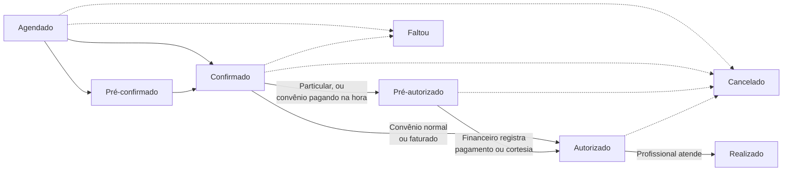

# Mapa geral do projeto — SMEDIM (backend)

> Gerado em 2026-07-21 a partir do código atual (`db.sqlite3` incluído) e das notas de sessões anteriores. Ver seção 5 para o que já mudou desde essas notas.

## 1. Apps Django

| App | O que faz |
|---|---|
| `accounts` | Login, usuários, perfis/permissões (Groups nativos do Django), troca de senha obrigatória, log de auditoria e tema claro/escuro + faixa de campanha do mês. |
| `cadastros` | Cadastros-base da clínica: pacientes, profissionais (com horários/exceções de atendimento), procedimentos, convênios (com tabela de preços), salas e guichês. |
| `agenda` | Agendamento de consultas/procedimentos por profissional: Central de Atendimento, agenda do dia, minha agenda, ciclo de status (confirmação → autorização → realização), pagamento particular e repasses. |
| `fila` | Totem de senha de autoatendimento (sem login) e painel de chamada/espera da recepção, com prioridade legal (Lei 10.048/2000) e filtro por especialidade. |
| `financeiro` | Telas de consulta/conciliação sobre dados que já vivem em `agenda` (contas a receber de convênio, estornos, fechamentos, repasses) — não tem models próprios. |
| `mensagens` | Chat interno 1-para-1 entre usuários do sistema (polling, sem WebSocket), com limpeza automática diária. |
| `prontuario` | Prontuário clínico unificado do paciente, preenchido pelo profissional ao realizar um atendimento, com sigilo automático para registros de saúde mental. |

## 2. Models por app

### accounts
- **Usuario** — usuário do sistema (login), com status (ativo/inativo/bloqueado), controle de tentativas de login, tema preferido e vínculo opcional a um profissional.
- **PermissoesSistema** — model *proxy* (não cria tabela) que só existe para registrar as permissões técnicas granulares do sistema.
- **ConfiguracaoTema** — configuração única (singleton) que liga/desliga a faixa de campanha de conscientização do mês.
- **LogAuditoria** — registro de ações sensíveis do sistema (quem fez o quê, quando e de qual IP).

### cadastros
- **Profissional** — médico ou demais profissionais de saúde da clínica, sempre autônomos.
- **HorarioAtendimento** — bloco fixo semanal de horário em que um profissional atende.
- **ExcecaoAtendimento** — substitui o horário fixo semanal numa data específica (ex.: troca pontual de turno).
- **Procedimento** — catálogo de consultas/exames/sessões oferecidos pela clínica.
- **Convenio** — convênio/plano de saúde aceito pela clínica.
- **TabelaPrecoConvenio** — preço de um procedimento específico para um convênio (geral ou por profissional).
- **Paciente** — cadastro de pacientes da clínica.
- **Sala** — consultório/sala física da clínica.
- **AtendimentoSala** — em qual sala um profissional escolheu atender em um dia específico.
- **Guiche** — guichê de atendimento da recepção.
- **AtendimentoGuiche** — em qual guichê um usuário da recepção escolheu atender em um dia específico.
- **EspecialidadePadraoUsuario** — especialidades que um usuário da recepção cobre habitualmente (baseline editado no cadastro do usuário).
- **AtendimentoEspecialidade** — especialidades que um usuário da recepção está cobrindo *hoje* (regravado a cada dia, base do filtro da fila).
- **LimiteDiarioProcedimento** — limite diário opcional de atendimentos de um profissional, usado como aviso (não bloqueio) na Central de Atendimento.

### agenda
- **Agendamento** — um atendimento marcado (paciente + profissional + horário), com todo o ciclo de status, forma de pagamento, recorrência semanal, encaixe e retorno grátis.
- **PagamentoParticular** — uma forma de pagamento (até 2 por atendimento) de um atendimento particular, com controle próprio de repasse e estorno.

Fluxo de status do `Agendamento` (o processo central do app):

### fila
- **Senha** — senha de atendimento tirada no totem (tipo Normal/Prioritário, especialidade, motivo de prioridade), com todo o ciclo aguardando → chamada → atendida.

### financeiro
- Nenhum model próprio (Fase 1). O app reaproveita `agenda.Agendamento` (`valor_convenio`, `convenio_recebido`) e `agenda.PagamentoParticular` — só reúne telas de consulta e conciliação em cima desses dados.

### mensagens
- **Mensagem** — uma mensagem de chat entre dois usuários (remetente/destinatário), com flag de lida.

### prontuario
- **EntradaProntuario** — um registro clínico do paciente (consulta/exame/procedimento), dividido em temas opcionais (queixa, histórico, avaliação, hipótese diagnóstica, conduta, observações), com sigilo automático quando a especialidade é de saúde mental.

## 3. Permissões (`accounts/permissoes.py`)

Organizadas por departamento — cada uma controla o acesso a uma tela/ação específica (via `permission_required` nas views, ou os grupos padrão do `seed_perfis`).

**Administração**
- `usuario_gerenciar` — criar, editar e bloquear usuários.
- `perfil_gerenciar` — gerenciar perfis e permissões (⚠️ ver seção 5 — hoje sem efeito real, a tela é restrita a superuser).
- `sistema_configurar` — configurar parâmetros gerais do sistema.

**Pacientes**
- `paciente_cadastrar` / `paciente_editar` / `paciente_excluir` — cadastrar, editar e excluir pacientes.

**Profissionais e Procedimentos**
- `profissional_gerenciar` — cadastrar/editar/excluir profissionais.
- `procedimento_gerenciar` — cadastrar/editar/excluir procedimentos.

**Convênios**
- `convenio_gerenciar` — gerenciar convênios e tabelas de preço.

**Agenda**
- `agenda_criar` / `agenda_editar` — criar e editar/cancelar agendamentos.
- `agenda_ver_propria` — ver apenas a própria agenda (profissional).
- `agenda_ver_dia` — ver a agenda do dia (apoio clínico).
- `atendimento_realizar` — registrar a realização de um atendimento.
- `central_atendimento_usar` — usar a Central de Atendimento (agendar por telefone).
- `limite_diario_gerenciar` — gerenciar limites diários de procedimento por profissional.

**Salas**
- `sala_gerenciar` — gerenciar cadastro de salas/consultórios.

**Guichês**
- `guiche_gerenciar` — gerenciar cadastro de guichês de atendimento.

**Fila / Senha**
- `fila_autorizar_recepcao` / `fila_autorizar_financeiro` — autorizar paciente na fila em cada etapa.
- `fila_chamar_senha` — chamar a próxima senha no painel.
- `fila_especialidade_configurar` — definir quais especialidades a recepção está cobrindo no dia.

**Financeiro** (uma permissão por página do menu desde 28/07 — ver seção 4)
- `financeiro_ver_painel` — ver o painel financeiro (resumo da semana).
- `financeiro_ver_movimentacoes_avulsas` — ver movimentações avulsas de caixa.
- `financeiro_ver_contas_receber` — ver contas a receber de convênio.
- `financeiro_ver_repasses_semanais` — ver repasses semanais (particular).
- `financeiro_ver_fechamento_diario` — ver fechamento diário.
- `financeiro_ver_fechamento_mensal` — ver fechamento mensal.
- `financeiro_ver_relatorio_detalhado` — ver relatório detalhado.
- `financeiro_ver_repasse_convenio` — ver repasse aos profissionais (convênio).
- `financeiro_ver_producao_convenio` — ver produção por convênio.
- `financeiro_ver_proprio` — ver apenas o próprio financeiro/produção (profissional).
- `financeiro_lancar` — lançar valores no financeiro.
- `financeiro_conciliar` — conciliar pagamentos.
- `financeiro_estornar` — estornar baixa de convênio (não mexe em dinheiro).
- `financeiro_estornar_pagamento` — estornar pagamento particular (devolve dinheiro ao paciente).

**Faturamento em lote (convênio)**
- `faturamento_lote_lancar` — criar lote de faturamento e incluir atendimentos nele.
- `faturamento_lote_visualizar` — ver lotes de faturamento e seus detalhes.
- `faturamento_comparativo_visualizar` — ver comparativo de produção x envio x retorno.
- `faturamento_retorno_lancar` — lançar retorno/glosa por atendimento do lote.

**Mensagens**
- `mensagem_usar` — usar o chat interno.

**Auditoria**
- `log_auditoria_ver` — ver o log de auditoria do sistema.

> Prontuário **não** tem permissão configurável de propósito — acesso é exclusivo de quem tem `Usuario.profissional_id` preenchido (checado direto em `prontuario/views.py`, sem `permission_required`), nem o Administrador tem acesso via perfil.

## 4. Fluxos documentados x código atual

Comparação entre as decisões registradas nas notas de sessões anteriores e o estado real do código/banco hoje (2026-07-21):

- ✅ **Retorno grátis (30 dias, por especialidade)** — ainda bate integralmente. `Agendamento.retorno_de`, `buscar_consulta_para_retorno`, `eh_retorno` e `valor_a_cobrar` (retorno = R$ 0,00 sempre) confirmados no código. A separação de "Retorno" como item próprio nos relatórios (atualização de 21/07) também está presente nas 4 funções de `financeiro/views.py`.
- ✅ **Slot de 15 min / atendimento simultâneo configurável / cache** — ainda bate. `SLOT_MINUTOS = 15` confirmado; `Profissional.limite_atendimento_simultaneo` confirmado; `accounts.middleware.DesabilitarCacheMiddleware` está registrado em `MIDDLEWARE` exatamente como descrito. Os `@never_cache` antigos ainda estão nas 3 views da agenda — redundantes desde o middleware, mas inofensivos (o próprio middleware pula respostas que já têm `Cache-Control`).
- ✅ **Fila por especialidade** — ainda bate. Fluxo do totem (especialidade → tipo → prioridade → emitir), `EspecialidadePadraoUsuario`/`AtendimentoEspecialidade` e a permissão `fila_especialidade_configurar` no perfil "Recepção / Atendimento" confirmados.
- ✅ **Ordem de prioridade no totem (Lei 10.048/2000)** — ainda bate, e já é a versão "com o gap fechado": `Senha.ORDEM_PRIORIDADE` é de fato usada em `chamar_proxima`/`_prioritario_ordenado`, e `MOTIVOS_PRIORIDADE` do totem é construída a partir da mesma lista (não duplicada).
- ✅ **Permissões de ações sensíveis (cancelar/estornar/pagamento)** — ainda bate integralmente. A trava de `agendamento_cancelar` (bloqueia se existe `PagamentoParticular` não estornado, exceto cortesia) está lá linha a linha; `financeiro_estornar` e `financeiro_estornar_pagamento` seguem como permissões separadas nas views corretas.
- ✅ **Edição de permissões restrita a super admin** — ainda bate integralmente. Decorator `_somente_super_admin` confirmado nas 4 views de Perfis, e o bloco de "permissões individuais" em `usuario_novo`/`usuario_editar` só roda `if request.user.is_superuser`. Os dois gaps que a própria nota já apontava como pendentes (não-superuser com `usuario_gerenciar` ainda pode se autoadicionar ao grupo "Administrador"; checkbox `perfil_gerenciar` sem efeito ainda aparece na tela) continuam exatamente como estavam — nada mudou.
- ✅ **Painel de chamada de senha** — ainda bate. `fila:painel_chamada` e `fila:painel_espera` confirmados (urls + views); `Senha.chamar_proxima`/`concluir_atendimento`/`chamar_novamente` presentes; nenhum `@never_cache` redundante foi adicionado (o próprio código comenta a decisão de confiar no middleware).
- 🆕 **Financeiro: permissão por página (28/07)** — antes, `financeiro_ver_completo` liberava de uma vez só 9 páginas do menu FINANCEIRO (Painel, Movimentações avulsas, Contas a receber, Repasses semanais, Fechamento diário, Fechamento mensal, Relatório detalhado, Repasse a profissionais, Produção por convênio) e `faturamento_lote_visualizar` liberava 2 (Lotes de faturamento e o comparativo Produção x envio x retorno) — não dava pra liberar uma sem as outras. Pedido do cliente: dividir em uma permissão por página (ver seção 3). `financeiro_ver_completo` foi removida (migration `accounts.0015_dividir_permissoes_financeiro` migrou automaticamente quem já tinha ela pras 9 novas, sem perder acesso); `faturamento_lote_visualizar` continua existindo, só mais estreita (perdeu o comparativo, que ganhou `faturamento_comparativo_visualizar` própria).
- ⚠️ **Perfis duplicados / rollout de usuários** — **parcialmente desatualizada**. Em 18/07 a nota dizia que Recepção, Financeiro, Apoio clínico e Call-Center não tinham nenhum usuário real. Consultando o banco hoje: o grupo **"Recepção" já tem 1 usuária real (`joici`)** — só Financeiro, Apoio clínico, Call-Center, "Recepção / Atendimento" e Administrador continuam com 0 usuários. Os três grupos "duplicados" (Recepção, Recepção / Atendimento, Call-Center) continuam existindo separadamente e não foram consolidados; hoje eles têm conjuntos de permissão *parecidos mas não idênticos* (todos têm `agenda_criar`+`agenda_editar`, mas "Recepção / Atendimento" tem `fila_especialidade_configurar` e `mensagem_usar` que os outros dois não têm). Nota lateral: como o gap de permissão da fila (`fila_chamar_senha` só em "Apoio clínico") ainda não foi resolvido no perfil, `joici` hoje tem esse código concedido **individualmente** (fora de grupo) como contorno pontual — o problema estrutural apontado nas notas de fila continua sem solução no nível de perfil.

## 5. Implementado x placeholder

**Praticamente todo o sistema planejado está implementado e funcional.** As seis etapas originais do projeto (login/perfis, cadastros, agenda, fila/senha, financeiro — a numeração "Etapa N" aparece nos docstrings do código) estão todas construídas e com URLs/views/templates completos, mais dois apps que não faziam parte da numeração original (`mensagens` e `prontuario`). Todos os fluxos de negócio centrais — ciclo de status do agendamento, pagamento particular com repasse, retorno grátis, fila com prioridade legal, estorno com trava de fluxo, sigilo de prontuário de saúde mental — têm regra de negócio implementada no model ou na view, não só a tela.

Placeholders e pontas soltas identificados:

- **`cadastros.models.Paciente.status_financeiro`** — a property ainda tem docstring e retorno dizendo "módulo financeiro ainda não implementado (Etapa 6)", mas o módulo `financeiro` existe e está em uso há tempo. A property não é chamada em nenhum template/view (confirmado por busca no projeto todo) — é código morto, sobra de antes do financeiro existir.
- **`accounts.models.Usuario.profissional_id`** — é um `PositiveIntegerField` solto (não uma ForeignKey de verdade), com comentário no código dizendo que "vira uma ForeignKey de verdade quando o cadastro de Profissionais for implementado na Etapa 3". A Etapa 3 (`cadastros.Profissional`) está implementada e em uso há tempo, mas o campo nunca foi convertido — continua sendo linkado só por convenção (`cadastros.models.Profissional.usuario_vinculado` busca por esse ID solto, não por FK).
- **`README.md`** — está parado na "Etapa 2": descreve só login/perfis e lista cadastros, agenda, fila e financeiro como "o que ainda não existe" — hoje os quatro estão implementados. Não é um doc em `claude/`, mas vale sinalizar porque é o primeiro arquivo que alguém novo no projeto tende a abrir.
- **Permissão de fila não alinhada** (`fila_chamar_senha` em "Apoio clínico" x `fila_especialidade_configurar` em "Recepção / Atendimento") — gap conhecido, decisão explícita do cliente foi "não mexer agora", ver seção 4.
- **Grupos possivelmente duplicados** (Recepção / Recepção-Atendimento / Call-Center) — ainda não consolidados; "Recepção" já tem uso real (`joici`), então uma futura limpeza precisa migrar usuário, não só apagar grupo.
- **`perfil_gerenciar`** — checkbox continua na tela de permissões, mas nenhuma view checa mais essa permission (foi substituída por `is_superuser`); deixado assim de propósito, não removido.

Nenhum app inteiro é "só placeholder" — o esqueleto mais fino é o `financeiro` (sem models próprios), mas isso é uma decisão de design documentada (reaproveitar campos de `agenda`), não uma feature pendente.
